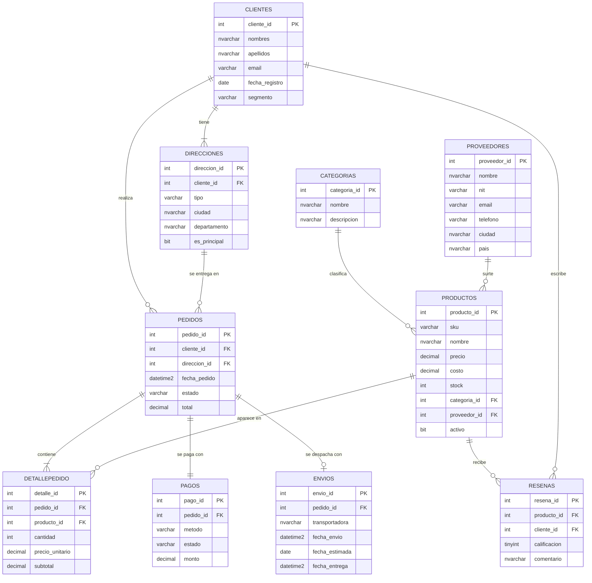

# 1. Modelo relacional (SQL Server)

**Caso de estudio:** TecnoHogar, una tienda en línea colombiana de tecnología y electrodomésticos. Vende a clientes de 12 ciudades, compra a 25 proveedores nacionales e internacionales y despacha con 5 transportadoras.

## Diagrama entidad-relación

## Las 10 entidades

| # | Tabla | Qué representa | Relaciones | Registros |
|---|---|---|---|---:|
| 1 | Categorias | Clasificación del catálogo | 1:N con Productos | 12 |
| 2 | Proveedores | Empresas que surten productos | 1:N con Productos | 25 |
| 3 | Productos | Catálogo con precio, costo y stock | N:1 Categoria, N:1 Proveedor | 150 |
| 4 | Clientes | Compradores registrados | 1:N Direcciones, Pedidos, Reseñas | 300 |
| 5 | Direcciones | Direcciones de entrega de cada cliente | N:1 Cliente | 452 |
| 6 | Pedidos | Encabezado de la orden | N:1 Cliente, N:1 Dirección | 700 |
| 7 | DetallePedido | Líneas (productos) de cada pedido | N:1 Pedido, N:1 Producto | 1.685 |
| 8 | Pagos | Pago de la orden | 1:1 Pedido | 700 |
| 9 | Envios | Despacho y entrega | 1:0..1 Pedido | 638 |
| 10 | Resenas | Calificación de un producto comprado | N:1 Producto, N:1 Cliente | 508 |
| | **Total** | | | **5.170** |

## Verificación de que las 10 entidades están relacionadas

El modelo tiene **11 llaves foráneas** y **ninguna tabla aislada**: todas participan al menos en una relación y forman un único modelo conectado.

| # | Tabla hija | Columna FK | Tabla padre | Cardinalidad |
|---|---|---|---|---|
| 1 | Productos | categoria_id | Categorias | N:1 |
| 2 | Productos | proveedor_id | Proveedores | N:1 |
| 3 | Direcciones | cliente_id | Clientes | N:1 |
| 4 | Pedidos | cliente_id | Clientes | N:1 |
| 5 | Pedidos | direccion_id | Direcciones | N:1 |
| 6 | DetallePedido | pedido_id | Pedidos | N:1 |
| 7 | DetallePedido | producto_id | Productos | N:1 (DetallePedido resuelve la relación N:M entre Pedidos y Productos) |
| 8 | Pagos | pedido_id (UNIQUE) | Pedidos | 1:1 |
| 9 | Envios | pedido_id (UNIQUE) | Pedidos | 1:0..1 |
| 10 | Resenas | producto_id | Productos | N:1 |
| 11 | Resenas | cliente_id | Clientes | N:1 |

Cómo se comprueba en SQL Server:

- `sql/03_validar_datos.sql` (consultas 1b y 1c) lista las llaves desde `sys.foreign_keys` y busca tablas sin relaciones (debe devolver 0 filas).
- La verificación de la aplicación (sección **0. Modelo relacional**) comprueba automáticamente: 10 tablas, 11 llaves foráneas, 0 tablas aisladas y más de 5.000 registros.

## Volumen

El taller pide **más de 5.000 registros** en total. Los datos están calibrados para quedar justo por encima de ese mínimo: **5.170**, con una distribución coherente con el negocio. Hay pocas categorías y proveedores (catálogos), y la mayor parte del volumen está en las tablas transaccionales (DetallePedido, Pedidos, Pagos, Envios). Los parámetros están al inicio de `src/datos/generarDatos.ts` (`N_PRODUCTOS`, `N_CLIENTES`, `N_PEDIDOS`, `PROB_RESENA`).

## Reglas de negocio implementadas en los datos

- El `total` de cada pedido es exactamente la suma de los `subtotal` de su detalle (`sql/03_validar_datos.sql` lo comprueba).
- Todo pedido tiene un pago. Pendiente → pago `Pendiente`; Cancelado → `Rechazado` o `Reembolsado`; el resto → `Aprobado`.
- Solo los pedidos `Enviado` o `Entregado` tienen envío. `fecha_entrega` existe solo si fue entregado.
- Una reseña solo la escribe un cliente que recibió el producto, y solo una por cliente-producto (`UNIQUE`).
- El `segmento` del cliente (Regular / Frecuente / Premium) depende de cuántos pedidos ha recibido.
- La demanda es desigual (pocos productos y clientes concentran gran parte de las ventas, como en un comercio real), lo que hace que las consultas muestren diferencias interesantes.

## Scripts

| Archivo | Uso |
|---|---|
| `sql/01_crear_bd.sql` | Crea la base `TecnoHogarDB`, las 10 tablas con PK, FK, CHECK, UNIQUE e índices |
| `sql/02_cargar_datos.sql` | Inserta los 5.170 registros (generado por `src/datos/generarDatos.ts` con `npm run generar-datos`, semilla fija) |
| `sql/03_validar_datos.sql` | Conteos por tabla, chequeos de coherencia y totales de control |
