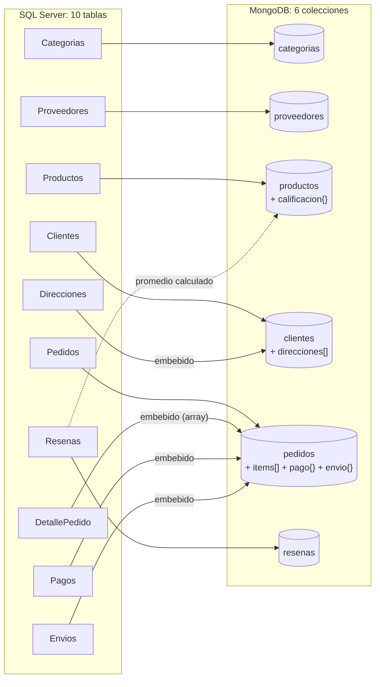

# 2. Modelo documental (MongoDB)

Base de datos: `tecnohogar`. Las **10 tablas** se transforman en **6 colecciones**.



## Mapeo tabla → colección

| Tabla(s) SQL Server | Colección | Técnica | Cómo queda |
|---|---|---|---|
| Categorias | `categorias` | Colección independiente | `{_id, nombre, descripcion}` |
| Proveedores | `proveedores` | Colección independiente + subdocumentos | `contacto{}` y `ubicacion{}` agrupan campos |
| Productos | `productos` | **Referencing** | `categoria_id` → categorias, `proveedor_id` → proveedores |
| Resenas (agregadas) | `productos.calificacion` | **Patrón computado** | `{promedio, total_resenas}` precalculado |
| Clientes + Direcciones | `clientes` | **Embedding** (array de documentos) | `direcciones: [ {...}, {...} ]` |
| Pedidos + DetallePedido + Pagos + Envios | `pedidos` | **Embedding** (array + subdocumentos) + **Referencing** | `items[]`, `pago{}`, `envio{}`; `cliente_id` y `items.producto_id` son referencias |
| Resenas | `resenas` | **Referencing** | `producto_id` → productos, `cliente_id` → clientes |

Las claves primarias de SQL Server se conservan como `_id`. Así cualquier documento se puede rastrear hasta su fila original, y las referencias entre colecciones usan los mismos valores que las llaves foráneas.

## Conversión de tipos

| SQL Server | MongoDB (BSON) | Comentario |
|---|---|---|
| `INT`, `TINYINT` | `int` | Sin cambios |
| `DECIMAL(12,2)` | número (`int` si es entero, si no `double`), redondeado a 2 decimales | Suficiente para pesos colombianos; si los centavos fueran críticos se usaría `Decimal128` |
| `DATE` | `date` (hora 00:00) | MongoDB no tiene tipo "solo fecha" |
| `DATETIME2` | `date` | Se guarda en UTC |
| `BIT` | `bool` | `1/0` → `true/false` |
| `NULL` | campo omitido | Ej.: un pedido sin envío no tiene la clave `envio`; los pagos contraentrega no tienen `fecha_pago` |

## Documentos de ejemplo

Los tipos TypeScript de cada documento están en `src/migracion/tipos.ts` (`PedidoDoc`, `ClienteDoc`, `ProductoDoc`...). El compilador comprueba que la transformación produzca exactamente esa forma.

### `pedidos` (une 4 tablas: Pedidos, DetallePedido, Pagos, Envios)

```json
{
  "_id": 2,
  "cliente_id": 237,
  "fecha_pedido": { "$date": "2024-07-31T19:34:05Z" },
  "estado": "Entregado",
  "direccion_envio": {
    "direccion_id": 353,
    "direccion": "Diagonal 7 # 10-18",
    "ciudad": "Cúcuta",
    "departamento": "Norte de Santander",
    "codigo_postal": "540541"
  },
  "items": [
    {
      "detalle_id": 5,
      "producto_id": 76,
      "sku": "TH-04-0076",
      "nombre": "Audífonos Bluetooth Andes Z78",
      "cantidad": 2,
      "precio_unitario": 381800,
      "descuento": 76360,
      "subtotal": 687240
    },
    {
      "detalle_id": 6,
      "producto_id": 147,
      "sku": "TH-03-0147",
      "nombre": "Monitor 24\" Kumo J83",
      "cantidad": 1,
      "precio_unitario": 1167400,
      "descuento": 0,
      "subtotal": 1167400
    }
  ],
  "resumen": { "num_items": 2, "unidades": 3, "subtotal": 1931000, "descuento": 76360, "total": 1854640 },
  "pago": {
    "pago_id": 2,
    "metodo": "Tarjeta debito",
    "estado": "Aprobado",
    "monto": 1854640,
    "fecha_pago": { "$date": "2024-07-31T21:23:05Z" },
    "referencia": "PAY0000002921"
  },
  "envio": {
    "envio_id": 1,
    "transportadora": "Interrapidísimo",
    "numero_guia": "INT7957403995",
    "estado": "Entregado",
    "fecha_envio": { "$date": "2024-08-01T17:34:05Z" },
    "fecha_estimada": { "$date": "2024-08-06T00:00:00Z" },
    "fecha_entrega": { "$date": "2024-08-05T15:00:00Z" },
    "costo_envio": 14175
  }
}
```

### `clientes` (une Clientes + Direcciones)

```json
{
  "_id": 2,
  "nombres": "Luis",
  "apellidos": "Medina Medina",
  "email": "luis.medina2@correo.com",
  "telefono": "3229920723",
  "fecha_nacimiento": { "$date": "1975-12-21T00:00:00Z" },
  "fecha_registro": { "$date": "2025-05-10T00:00:00Z" },
  "segmento": "Regular",
  "direcciones": [
    {
      "direccion_id": 2,
      "tipo": "Casa",
      "direccion": "Calle 59 # 85-38",
      "ciudad": "Bogotá",
      "departamento": "Cundinamarca",
      "codigo_postal": "110249",
      "es_principal": true
    },
    {
      "direccion_id": 3,
      "tipo": "Oficina",
      "direccion": "Transversal 15 # 73-9",
      "ciudad": "Bogotá",
      "departamento": "Cundinamarca",
      "codigo_postal": "110124",
      "es_principal": false
    }
  ]
}
```

### `productos` (referencias + resumen calculado)

```json
{
  "_id": 33,
  "sku": "TH-09-0033",
  "nombre": "Bombillo Inteligente Cóndor X48",
  "precio": 649800,
  "costo": 504500,
  "stock": 2,
  "activo": true,
  "fecha_creacion": { "$date": "2023-07-07T00:00:00Z" },
  "categoria_id": 9,
  "proveedor_id": 22,
  "calificacion": { "promedio": 3.83, "total_resenas": 24 }
}
```

### `resenas`, `proveedores`, `categorias`

```json
{
  "_id": 1,
  "producto_id": 147,
  "cliente_id": 237,
  "calificacion": 5,
  "comentario": "Excelente producto, lo recomiendo.",
  "fecha": { "$date": "2024-09-01T20:00:00Z" }
}

{
  "_id": 1,
  "nombre": "Orbis Andina Importaciones",
  "nit": "900257332-5",
  "contacto": { "email": "ventas1@proveedor1.com", "telefono": "6034590519" },
  "ubicacion": { "ciudad": "Cartagena", "pais": "Colombia" }
}

{ "_id": 1, "nombre": "Celulares", "descripcion": "Smartphones y teléfonos básicos" }
```

Observe que la reseña 1 es del cliente 237 sobre el producto 147, el mismo cliente y producto del pedido 2 de arriba: solo puede reseñar quien recibió el producto.

## Índices creados

| Colección | Índice | Para qué |
|---|---|---|
| clientes | `email` (único) | Login y búsqueda de cliente; evita duplicados |
| clientes | `direcciones.ciudad` | Índice multikey sobre el array embebido |
| productos | `sku` (único), `categoria_id`, `proveedor_id` | Búsqueda por SKU y `$lookup` desde categorías/proveedores |
| pedidos | `{cliente_id: 1, fecha_pedido: -1}` | Historial de un cliente ordenado por fecha (consulta 8) |
| pedidos | `fecha_pedido`, `estado` | Filtros por periodo y estado (`$match` de casi todas las consultas) |
| pedidos | `items.producto_id` | Índice multikey: "¿en qué pedidos aparece este producto?" |
| resenas | `producto_id`; `{cliente_id, producto_id}` (único) | Reseñas de un producto; replica la regla UNIQUE de SQL Server |

Además, la colección `pedidos` se crea con un **validador `$jsonSchema`** que exige `cliente_id`, `fecha_pedido`, `estado` (con valores permitidos) y al menos un elemento en `items`. Recupera en MongoDB parte de las restricciones `CHECK` y `NOT NULL` que tenía SQL Server.
